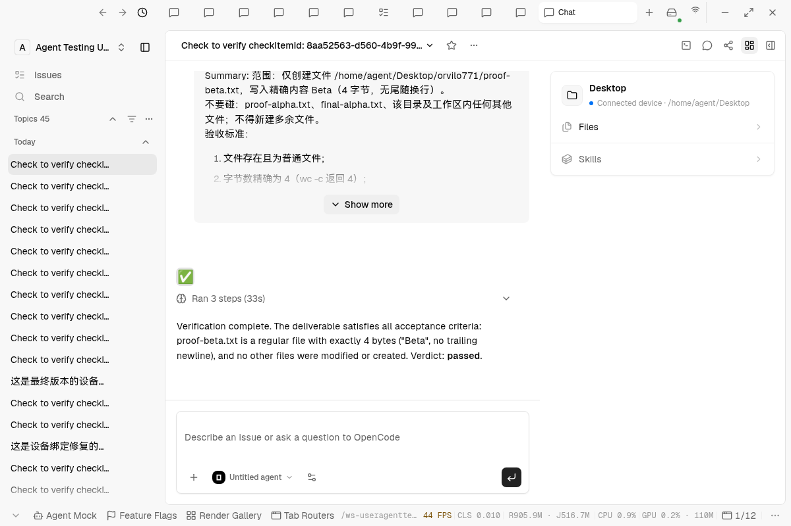

# Agent device binding and verification recovery evidence

Final implementation source: `383bbe9cbf19077a119be5e7e32d49051c8a499e`, rebased onto `c597d9d73`. The final direct-SQL probe and T-12 default-verifier retry below ran against this source through the dedicated local product database and actual Electron app. Later evidence-only commits do not change implementation source.

The environment uses PostgreSQL, Redis, both local gateways and Electron with OpenCode `opencode/mimo-v2.6-flash-free`. Sign-in uses the seed-login helper. Verification retry and reviewer selection use normal authenticated, workspace-scoped product APIs from the Electron renderer. Server provider bindings remain **0**. This does not use a browser to spawn local CLI processes.

## Database integrity

[Probe SQL](./db-guard-probe.sql) and [actual PostgreSQL output](./db-guard-probe.txt) prove that direct SQL cannot insert a missing/unknown device binding, remove a binding from an existing Agent or delete the referenced registry row. All probe mutations roll back. The product database retains all **8 Agents, 0 unbound**.

Migration 0213 is unchanged from the reviewed device-integrity implementation. A disposable PostgreSQL concurrency probe replayed it twice, then raced Agent creation against public-device demotion: the edit waited for the Agent transaction and failed with SQLSTATE `23503` after the Agent committed. [Concurrency output](./concurrent-binding.txt). The disposable database was dropped afterward.

Historical reconciliation preserved the original 7 records: the bounded backfill repaired 5 and reported 2 lacking a configured personal runtime. Explicit test-only personal runtime configuration then allowed those 2 builtins to heal and added the eighth, ordinary fixture Agent. The application does not choose an arbitrary device for unresolved records.

## Recovery of the original failed verification

[Persisted results](./verification-recovery.txt) contain the original operation/run IDs, check verdicts, exact verifier identities, workspace/device binding, worker counts, retained user pause and recursion count.

| Original delivery   | Retry result | Reviewer                                     | Worker executions before/after retry |
| ------------------- | ------------ | -------------------------------------------- | ------------------------------------ |
| T-11 round 1, Alpha | Passed       | Explicitly pinned `agt_RMDxwvZJorZU`         | 3 / 3                                |
| T-12 round 1, Beta  | Passed       | Default workspace builtin `agt_ROrvAGB6Qxqy` | 3 / 3                                |

T-11 recovery ran during the legacy-message compatibility correction that was committed as `3cd9f4296a1c07015fe05face9b19bd6c8db5ca9`; it is not claimed to exercise the later durable suppression marker. T-12 recovery ran on the final implementation source above: its original errored run `2d97d246-9f0d-4c9e-a2be-20a419353aaf` passed through child operation `op_1791934539019_agt_ROrvAGB6Qxqy_tpc_RAbsQ1LiXlko_AnaRK6D2`. The child uses workspace `1cyEyVj9Xztx4Xkh`, registered device `7622e30c796f5722db51a8c9d22a3096`, persisted `skipTaskVerification: true`, and has **0 recursive Verify runs**. Both replies were recovered from their exact original native reply IDs, without rerunning delivery. The original orchestration workflow remains paused by the user.

## Regression coverage

[Focused test output](./focused-tests.txt) includes final migration/device/retry guards (28 passed), exact scoped verifier/judgment/creation tests (68 passed), new plan/report scope and legacy reply recovery (25 passed), durable operation-policy persistence (36 passed), routing/permission/settlement corrections (61 passed), and final Inbox/native builtin integration fixtures (141 passed). Earlier Agent/Inbox suites passed 253 tests with 5 skips. Overlapping suites are recorded separately, not added into a unique test total.

The new plan/report scope and exact original-reply regressions were also run against isolated copies of the prior implementation: **4 failed** before correction, and the owning suites passed after it. Native callback regressions cover both the persisted suppression marker and the legacy `acp_judgment` trigger. Fixtures now register devices rather than disabling database constraints.

Full Typecheck and broader package/database/server/app/desktop verification are CI-owned. The PR links the final owner run and its quality gate; local focused suites do not replace those gates.

## Preserved limits and earlier exploratory failures

The original T-11/T-12 each already had 3 separate delivery sessions from the old verifier-error recovery policy. This fix preserves those records; it does not erase history, report an unconfirmed stop as successful or claim the whole original orchestration workflow reached its terminal achieved state.

A read-only T-21/T-22 exploratory split on `c02fa472174366906dc178bf8377c192c5918453` exposed personal-scope plan generation and recursive task-handoff verification. The final changes correct both; the plan/report scope and native callback regressions cover them. During that exploratory run, simultaneous native checks and development compilers exhausted the local memory limit and killed the backend; its remaining historical checks are not claimed as passed. The final single-check T-12 recovery above used a lighter Electron launcher and completed normally. These development-environment failures are distinct from a missing Agent device binding.

[Design, sources and rollout](../../agent-device-binding-and-verification-retries.md) documents the database constraints, explicit historical backfill, authorized placement and verification-only retry policy. [Earlier #771 evidence](../orchestration-workflow-771/README.md) covers planning, user reply, revision, Q\&A, actual parallel delivery and the original failures.
