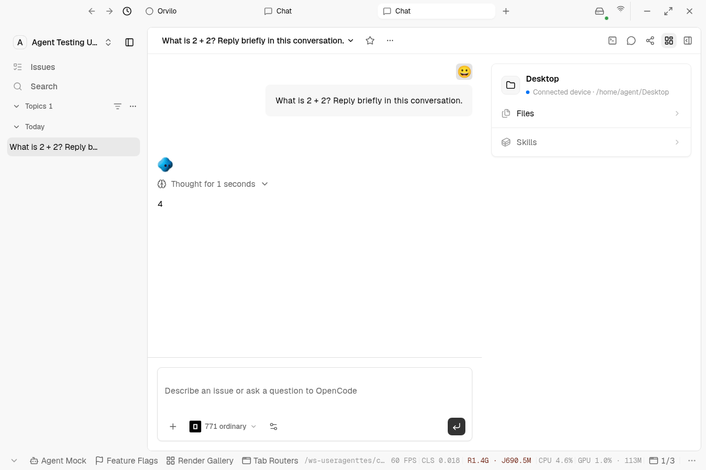
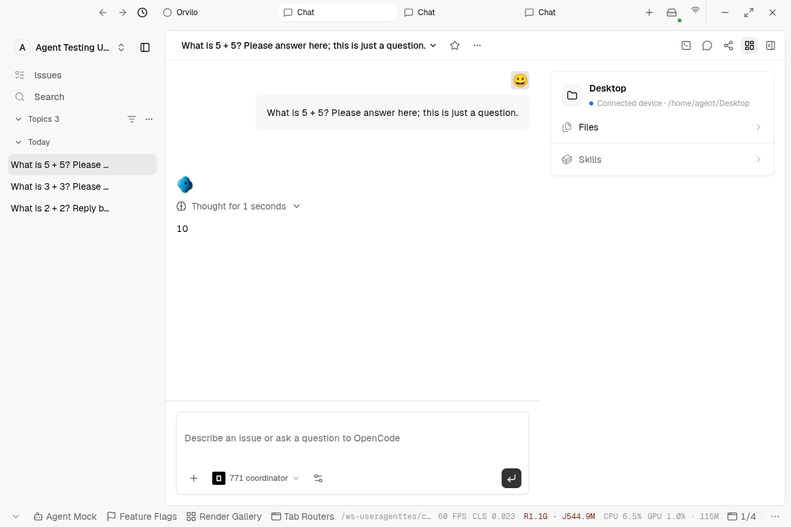
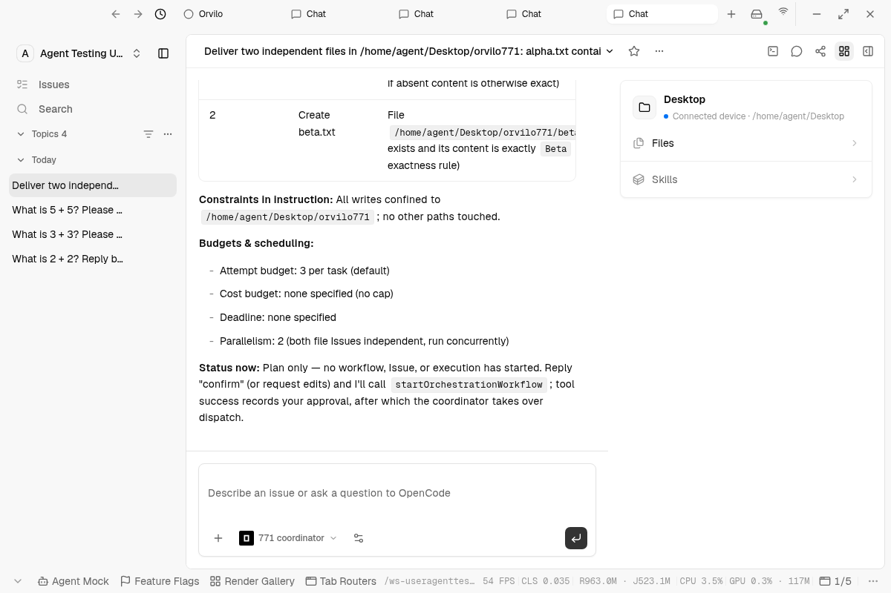

# #771 Electron verification

Backend revision exercised: `76d56bf9f69e0ccf6167a563885abc087538f657`.

The dedicated local environment uses Electron 43.2.0 under Xvfb, PostgreSQL, Redis, both pinned local gateways (`81f26f8af942484da644921eae08371f834bfd72`), and OpenCode 1.19.0 with `opencode/mimo-v2.6-flash-free`. No server model/provider binding is configured (`provider_bindings` count: 0). Two public test Agents bind to the enrolled workspace device; the coordinator is the workspace's configured Orchestrator. The test device's approved working directory is `/home/agent/Desktop`.

The renderer and main process were signed in through the existing local seed-login helper. The test device was shared through the actual workspace enrollment API. Agent setup uses the same public config factory and API as the UI. Conversation sends and inspection use the real Electron renderer through CDP.

| Scenario                                                                             | Observed result                                                                                                                                                                                                               |
| ------------------------------------------------------------------------------------ | ----------------------------------------------------------------------------------------------------------------------------------------------------------------------------------------------------------------------------- |
| Ordinary Agent, `What is 2 + 2? Reply briefly in this conversation.`                 | Real OpenCode response `4`; operation actor `agt_RMDxwvZJorZU`, status `done`; 0 orchestration workflows.                                                                                                                     |
| Orchestrator, `What is 5 + 5? Please answer here; this is just a question.`          | Real OpenCode response `10`; actor `agt_D8XfGW18Nrwz`, status `done`; 0 orchestration workflows.                                                                                                                              |
| Delivery of independently accepted `alpha.txt` and `beta.txt`, plan before execution | Orchestrator presented both Issues, criteria, scope, attempt budget and parallelism; before approval, 0 orchestration workflows and 0 Issues.                                                                                 |
| Confirm strict contents with no trailing newline                                     | Full `startOrchestrationWorkflow` permission question reached the dialog; the MCP client timed out before approval. The Agent truthfully said approval was unconfirmed and did not execute; 0 orchestration workflows/Issues. |

The timeout reproduction found that builtin approval did not forward the existing AskUser progress callback to MCP. A follow-up fix forwards progress every five seconds while human review is pending. Plan permission options now put **Deny first**, because the existing question UI selects its first option on timeout; it must not auto-approve an orchestration plan. The producer's complete JSON preview remains untruncated. Focused progress, default-deny and migration regressions pass.

Remaining acceptance: verify a human review longer than the MCP idle timeout, approve through the real dialog, and observe multiple Issues and actual dispatch with no server model. This document does **not** claim those steps passed. PR #779 remains draft until that evidence and CI are complete.

Environment failures encountered before the successful scenarios: Vite OOM during initial renderer compilation; absent default Desktop directory misreported as CLI-not-found; private-Agent creation blocked by the workspace's public-Agent rule; absent Agent Gateway in Electron's startup config snapshot. These were resolved in the dedicated test environment without frontend behavior changes.
