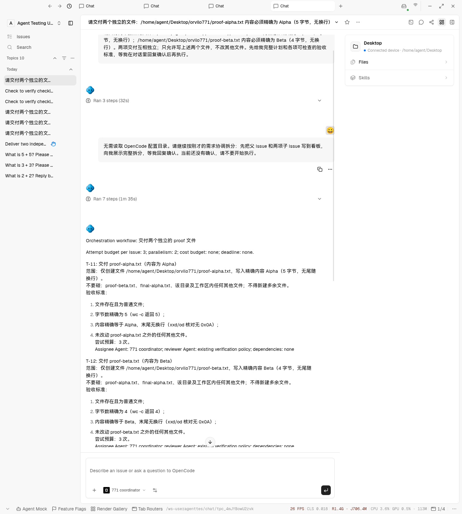
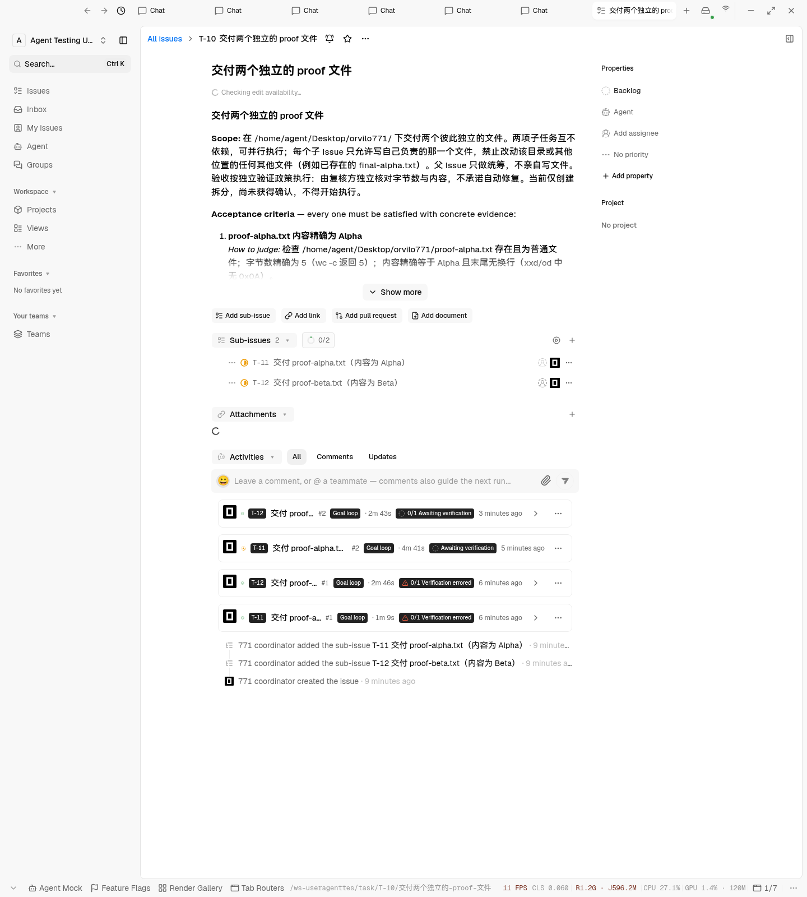
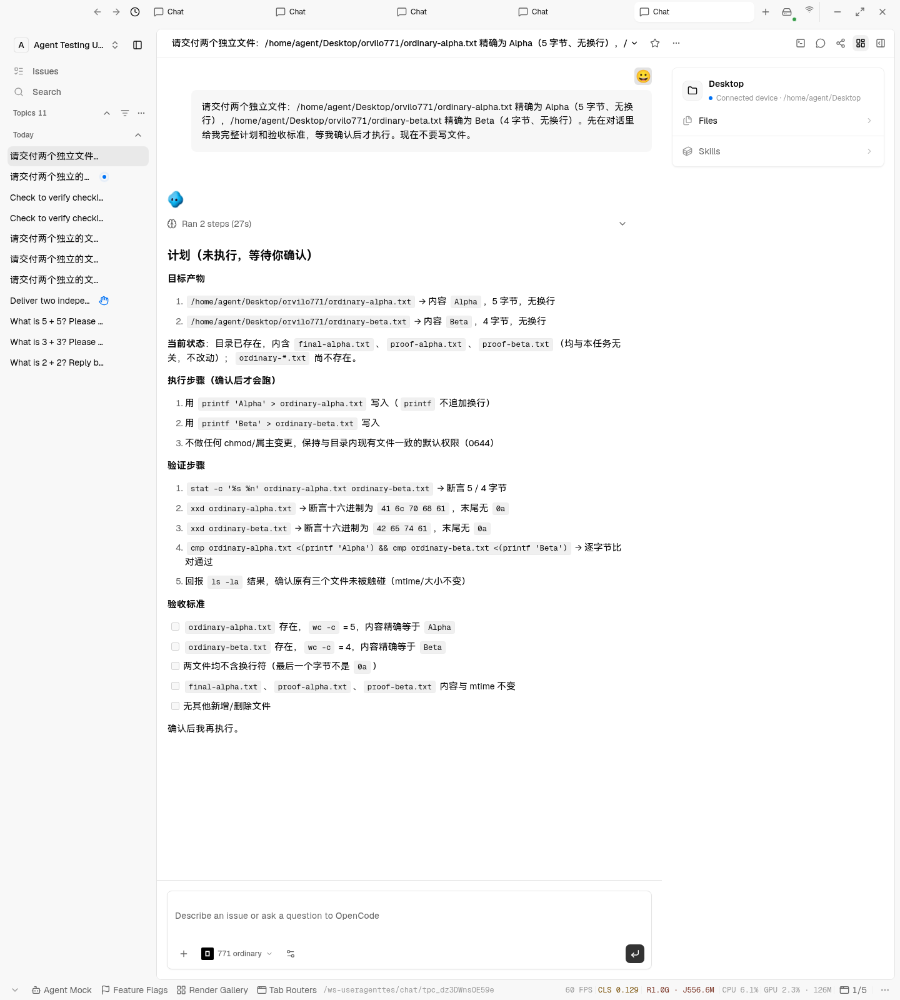
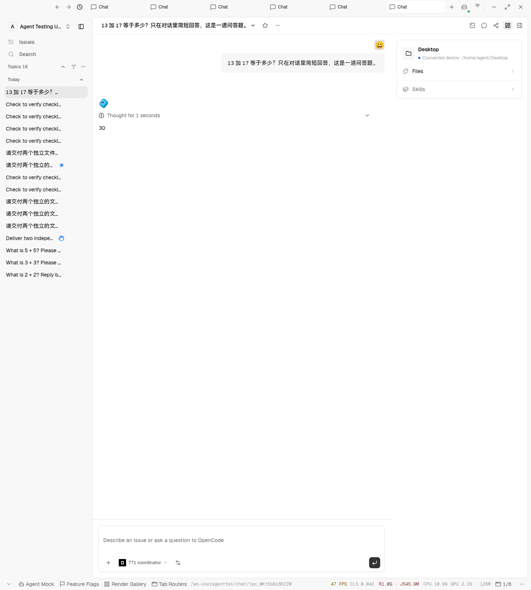
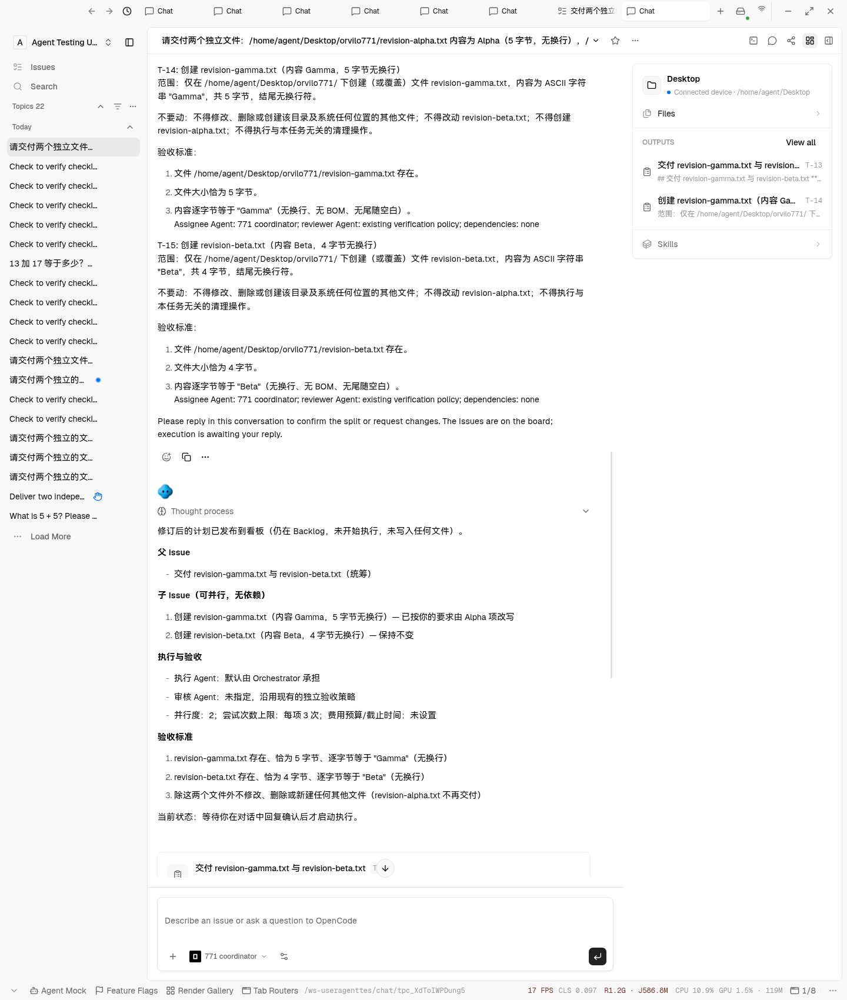

# #771 Electron verification

Planning, conversation reply, real board Issues and file delivery were exercised on backend revision `b31e830e2b39766c3830c9ec43a068e8fcd5b30d`. The later canonical reviewer-policy correction has a regression that failed before the fix and passed afterward; its live API check is recorded in PR #779 at that correction's commit SHA.

The dedicated local environment uses Electron 43.2.0 under Xvfb, PostgreSQL, Redis, both pinned local gateways (`81f26f8af942484da644921eae08371f834bfd72`), and OpenCode 1.19.0 with `opencode/mimo-v2.6-flash-free`. No server model/provider binding is configured (`provider_bindings`: 0). The public coordinator and ordinary Agents bind to the enrolled workspace device. The coordinator is the workspace's configured Orchestrator. The approved working directory is `/home/agent/Desktop`.

Sign-in uses the existing seed-login helper. Device enrollment and Agent configuration use public product APIs. Requests, confirmation, reload and screenshots use the actual Electron renderer through CDP. No orchestration rows, dispatch receipts or deliverables were manually inserted.

| Scenario                                                       | Observed result                                                                                                                                                                                                                                                                                        |
| -------------------------------------------------------------- | ------------------------------------------------------------------------------------------------------------------------------------------------------------------------------------------------------------------------------------------------------------------------------------------------------ |
| Plain request for two independent files, plan before execution | Real parent T-10 and distinct children T-11/T-12 created on the board. Both children are Backlog; no confirmation stamp; 0 child dispatches; `getStatus.waitingReason` is `plan_not_confirmed`.                                                                                                        |
| Reload before replying                                         | Complete persisted split remains in the conversation: descriptions, checkable byte criteria, effective assignee, verification policy, dependencies and budgets.                                                                                                                                        |
| Normal conversation reply confirming the split                 | Confirmation stamped at `2026-10-13T17:49:08.392Z`; orchestration workflow becomes running. Both independent child Issues actually dispatch, using the coordinator Agent, the real user as initiator, and CAID origin. Parent has 0 dispatches. No Start or confirmation dialog is used for this step. |
| Delivery by the two child Issues                               | `proof-alpha.txt` is exactly `b'Alpha'` (5 bytes); `proof-beta.txt` is exactly `b'Beta'` (4 bytes). Both have no newline. Worker operations reach `done`; downstream verification is a separate result.                                                                                                |
| Equivalent plan-first request to ordinary Agent                | Ordinary Agent provides a conversation plan and waits. Its operation finishes; it creates no orchestration workflow, and neither `ordinary-*.txt` file exists.                                                                                                                                         |
| Orchestrator Q\&A, 13 + 17                                     | Replies `30` in the conversation; operation finishes; no new orchestration workflow.                                                                                                                                                                                                                   |
| Pause through conversation API                                 | State becomes paused and `getStatus.waitingReason` becomes `paused`; the test attempt is paused after collecting delivery evidence.                                                                                                                                                                    |

See [runtime-checks.txt](./runtime-checks.txt) for fixture ids and compact observations. Screenshots preserve the frontend owner's existing copy, including old labels in execution history; this backend PR does not change those labels.

## Revision path

Revision `f1f179f4dd63f38f796fa6345e65879b2507321a` exercised a plain second request and a change request through real Electron. The coordinator prepared parent T-13 and children T-14/T-15, then used normal Issue tools to change Alpha to Gamma on the existing parent/child Issues. It reposted the same split, resetting `postedAt` from `2026-10-13T18:15:01.999Z` to `2026-10-13T18:18:01.556Z`. The orchestration workflow id, parent and child ids remained the same; confirmation stayed absent and total parent/child dispatches remained 0. No revision output files were created. The stale internal parent title/terminal criteria observed in this attempt were subsequently fixed and covered by a regression that fails before and passes after the correction.

The final live repost on source revision `f824ff665cb1acee9113e5f360f49359fca813a9` advanced `postedAt` to `2026-10-13T18:58:09.370Z`. The internal title follows Gamma/Beta, and the three required Agent criteria have current parent/Gamma/Beta instruction documents. Existing T-13/T-14/T-15 remain planning/unconfirmed, with 0 total dispatches and all three revision output files absent. The Electron conversation shows the revised full split and awaits a reply.

## Limits and failures observed

The independent verification engine did not complete in the original test setup: the default builtin reviewer had no bound device, and an ACP task-handoff judgment also returned no parseable JSON. File delivery and actual dispatch are proven; a final verified/achieved result is not claimed. The existing verification engine is retained, with independent reviewer work separately tracked in #769. An available device-bound reviewer can be selected through the ordinary Issue verification settings; that selection must be reflected by the card API and posted plan.

The screenshot's T-11/T-12 rounds #1 and #2 are actual executions, not duplicate rendered records. Both first verification checks errored with `No bound device`; graph events then record automatic recovery after verification feedback. Every round has a different Topic and native OpenCode session id, under the same assigned Agent. Later both Issues reached a third round; T-12's third check passed, while T-11's third round remained unresolved. The orchestration workflow is paused. An ordinary `task.cancelTopic` cleanup request returned `STOP_UNCONFIRMED`, so the remaining execution is not reported as stopped. These observations describe the retained verification/recovery engine and do not claim a completed end-to-end acceptance result.

The first request encountered an unrelated OpenCode request to read its configuration directory; it was rejected. A normal follow-up asked the Orchestrator to continue without that read. It first guessed an invalid Agent id; the server rejected it without creating partial Issues. It then prepared the split using effective defaults. The tool descriptions and Orchestrator instructions now explicitly say to use real accessible ids and explain omitted assignee/reviewer defaults accurately.

Earlier revision `76d56bf9f69e0ccf6167a563885abc087538f657` supplied the archived `ordinary-qa.png`, `coordinator-qa.png` and `plan-before-confirmation.png`. Those images predate the owner's final conversation-reply requirement and do not prove the current start protocol. No old permission-dialog approval is claimed as current acceptance.
