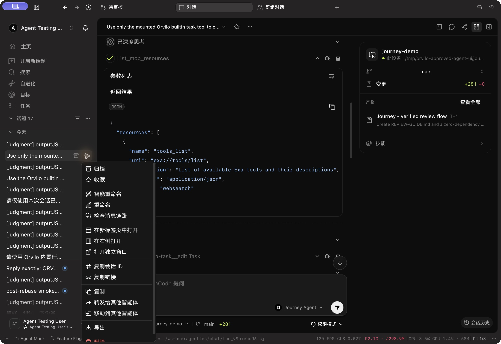
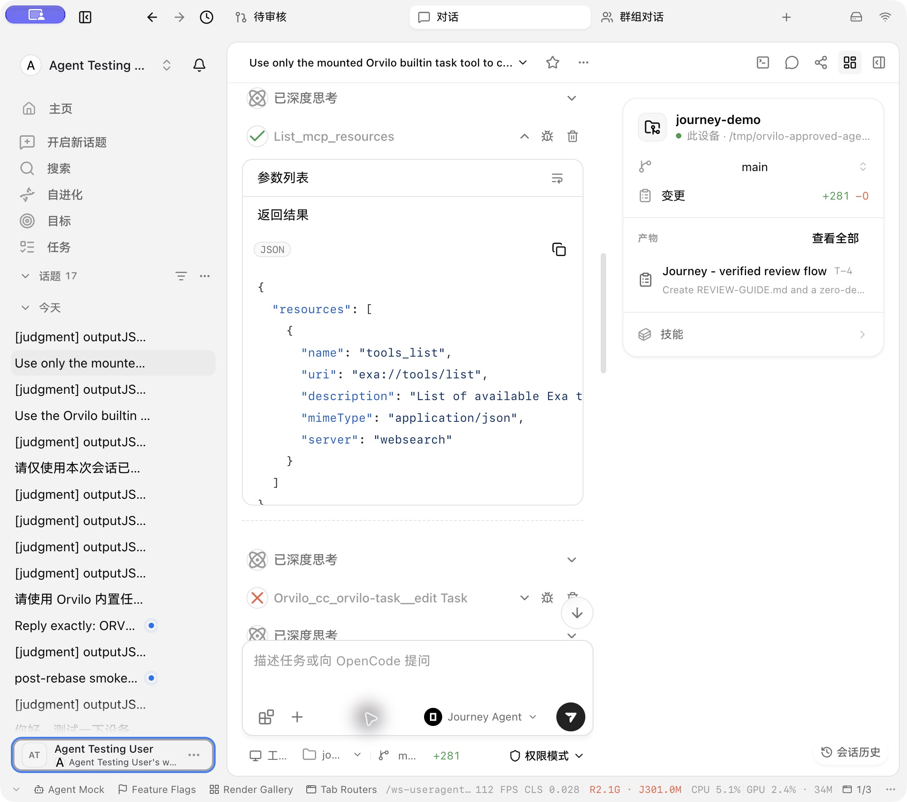

# UI migration recovery

The migration to composable UI components must preserve each caller's existing controls and layout. This recovery addresses the photographed conversation and topic-menu regressions.

- Menus size to their content, with a 192px default minimum and the platform's available-width cap. Explicit widths and multiline descriptions remain supported.
- Shorthand CodeBlock restores language and copy controls. Explicit children own the chrome; copy-only children preserve intentionally hidden language labels. Embedded tool code uses ghost framing inside its enclosing card.
- Edited-file previews use semantic diff rows and dual line numbers; their copy control keeps the original patch, including file headers and addition/removal markers. Metadata-only patches retain readable text.
- Accordion actions sit beside the trigger. Callers that allow independent sections explicitly set multiple. Labelled dividers use two lines around their label.
- Conversation paragraph spacing and process-to-result spacing are restored. The syntax-theme preview uses the same highlighter as conversation Markdown and receives the selected theme.

## Verification

Renderer source revision: [`599b11e5bc00a575ef9cc99548c8e48d0563d1d3`](https://github.com/alexj11324/orvilo1/commit/599b11e5bc00a575ef9cc99548c8e48d0563d1d3). GitHub still serves this original verification commit after the patch-equivalent rebases. The authenticated Electron fixture displayed the existing twelve-call conversation. Its empty-argument resource result has one outer frame and one divider; Copy changed to Copied, and the independent expand action kept the workflow open. Long Chinese topic actions remain on one line. Native windows were checked at approximately 1000px and 1290px in dark and light appearance.

Forty focused rendered regressions pass (CodeBlock, workflow actions, edited-file previews, empty arguments). The owning package checks add 31 tests, and the sidebar menu adapter adds five. The new CodeBlock test exercises actual clipboard output and rendered opt-outs; it is retained to satisfy the repository's bug-regression requirement despite the component-test advisory. Remote Typecheck and full E2E status are separate CI gates.

## Review follow-up

The shared unified-diff parser counts remaining old/new hunk lines before recognizing file headers, so removed CSS custom properties and added source beginning with `++ ` remain visible. Copy controls reuse the existing English and Simplified Chinese `common.copy` and `common.copySuccess` translations; explicit caller labels retain precedence. The rendered/parser regression set passes 26 checks, including the newly reproduced failures. Original screenshots cover the unchanged framing. Follow-up renderer verification on `1dd452becde9cc2dfbdfd24c360db7be80eccce4` uses a manually seeded display fixture: [native diff](ui-migration-evidence/1dd452bec/diff-content-final-native-1dd.jpg) retains the removed `--color: red`, added `++ value` and later file hunk. [Native accessibility feedback](ui-migration-evidence/1dd452bec/copy-feedback-1dd.ax.txt) records the button changing to 已复制；[clipboard paste](ui-migration-evidence/1dd452bec/copied-original-patch-native-1dd.ax.txt) records the full original two-file patch. The feedback screenshot did not visibly show that label, so accessibility evidence is used for this outcome. No model or file-edit execution is claimed. The fixture draft was cleared; original clipboard restoration is not claimed. [Affected source hashes](ui-migration-evidence/1dd452bec/source-hashes.json) remain unchanged on combined candidate `233f3cbe04467e6aea252faacec56b93c43f7df9`, which retains the actual tested revision as an ancestor.

## Shared controls and design roles

Shared Toggle and Autocomplete now use the ordinary control role from [DESIGN.md](../../DESIGN.md). Dense toolbar callers explicitly request `compact`; small property controls request `sm`, and larger actions request `large`. ToggleGroup inherits an explicit group size while preserving a child's explicit size when the group omits it. The existing `lg` spelling remains compatible. Shared descriptions, labels and code defaults use the approved text roles. Fixed spacing and numeric leading aliases preserve physical geometry when the user's root font changes; authored overrides remain supported.

Multiple Select forwards `onOpenChange` for opening and closing. Pressing Escape while its popup is closed preserves selected values; pressing Escape while open closes it, and the clear control remains a separate action. WorkSurface retains its content caps, responsive gutters and scroll ownership. Avatar and group frames use semantic radii while preserving public shape, image, fallback and caller-style behavior.

[Current verification and original artifacts](https://github.com/alexj11324/orvilo1/blob/5688f6a1d30ed49f223598148791ca4ec1e73f44/docs/evidence/design-md-controls-496b70b/README.md) bind product revision `496b70b6e6d4a9b55f7a5be42459808f88a9d75a`. The real Electron component fixtures cover light/dark, wide/narrow windows and two root font sizes. Original failed screen-reader-only assertion reports remain unchanged; a separate strict parser result verifies Chromium's recorded important overflow declarations. This evidence covers the changed components, not the full routed application or the remaining migration goals.

## Local layout and content behavior

The local migration consumes the named typography, semantic-color and radius roles in [DESIGN.md](../../DESIGN.md). Body labels, metadata and emphasis retain their distinct text roles and root-font scaling. Description and status ink use their text roles; washes remain separate from opaque surfaces. Cards, controls and overlays use their purpose-specific radii. SelectCircle names its fully round circle role through the local `--select-circle-radius: 50%` token. Each corner radius follows its own edge, preserving circles for square dimensions and ellipses for unequal caller dimensions without a finite pixel cap. Explicit caller radius classes retain precedence. Current native counterprobes isolate radius paint with unchanged geometry, colors and glyphs; this source repair still requires a fresh independent review and strict real Electron paint verification. HumanCursor keeps its SVG, white contour, actor color and label without the former drop shadow. Unsupported-file media uses the local EmptyMedia icon treatment.

Inspector status glyphs use their existing flex row's cross-axis centering; statuses nested inside receipt text use ordinary inline middle alignment. Signed optical margins are removed. QuestionPanel and RegionNotes number markers center metadata text on both flex axes instead of forcing a marker-height line box. These changes introduce no additional exception for a legacy size, shadow or optical offset.

Status glyph strokes consume the semantic `success-text` and `destructive-text` roles. Filled RegionNotes number markers pair their destructive fill with the `destructive-on-fill` foreground. This corrects semantic color roles and may change rendered RGB values; it does not claim color equivalence with the former declarations.

ResourceManager's masonry toolbar and selection hint share one opaque sticky header. Both children stay in normal flow, so wrapped controls and larger fonts determine the hint's position without a fixed 53px offset. The virtualized list owns scrolling in a stable flex viewport below that same opaque header, without a fixed height calculation. Genuine selection, filter and load-more handlers remain. Code folding targets the region's actual source start line (`foldRegion.start`), rather than a displayed row index; custom starting line numbers do not redirect the fold. ReadKnowledge FileCard keeps preview padding outside the clamped text, leaving up to four complete text rows without clipping the fourth row or exposing a partial fifth.

This section records source behavior, not a Native or remote CI pass. The eight SDK-owned migration blockers remain separate work; this local update does not mark them complete.
