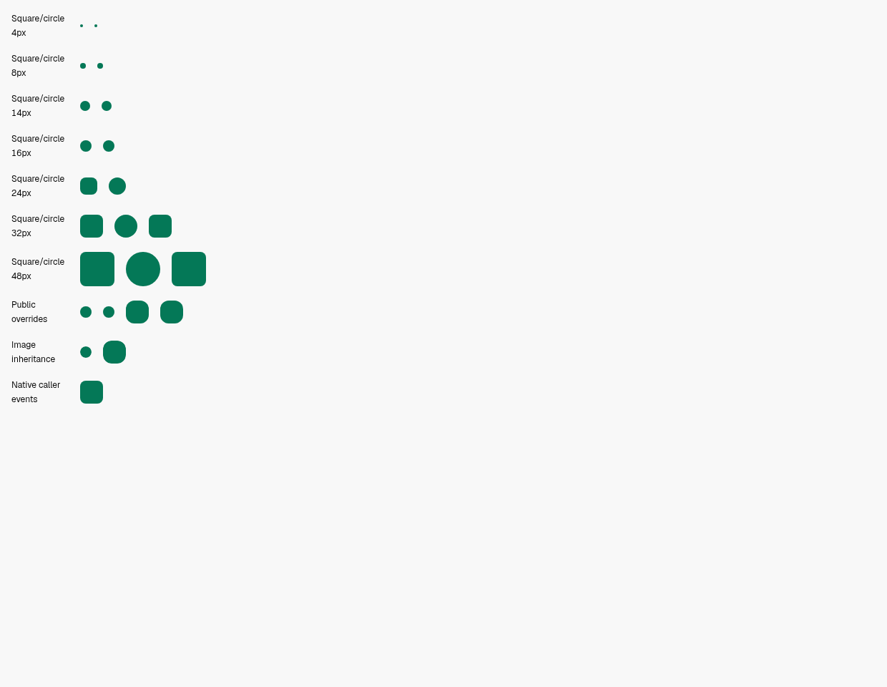
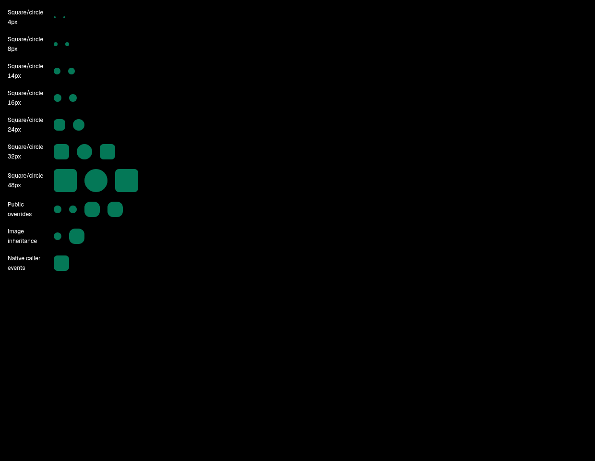

# Small square Avatar repair — real Electron evidence

Product revision: [`e68c5d662f0089553b2a6577eef6ea4737b0123b`](https://github.com/alexj11324/orvilo1/commit/e68c5d662f0089553b2a6577eef6ea4737b0123b). Original baseline: `f7a97a528489e5e4d6e85431365ded85568346fb`. This is the scoped repair for [PR #781](https://github.com/alexj11324/orvilo1/pull/781)'s small square Avatar P2; it does not close the migration Goal.

The square token consumes the 8px card role as a ceiling and caps each corner at 25% of its edge. Current 14px/16px entity identities retain straight edges; default squares of 32px and above retain 8px. Circle, public class/style radius overrides, native image inheritance and caller events remain available. The independent review accepted the current necessity, source and delivered behavior; previous exception records were not its basis.

Actual after007: **336 PASS / 0 FAIL**, eight real Electron contexts: light/dark, 1240/390px, root font 16/20px. The genuine Desktop Vite/AppTheme/public SDK5.56/locale/Query pipeline uses actual production CSS and live CSS module exports; dev styles are disabled and computed differences are zero. Electron sandbox, context isolation and web security remain enabled. The process lease closed, exit0, OOM0. Actual scoped before006 circle callers: **80 PASS / 0 FAIL** in the same eight contexts.

Original before004 remains a raw **FAIL**, 296 checks with 44 failures: 32 real small-square failures and eight missing scoped module-cap bindings; four independent-tile circle raster comparisons were invalid despite correct full-radius CSS. The replacement compares the same real node, origin and image through controlled public props, exact full original RGBA and restoration. The remaining Avatar witness is byte-identical. Original failed001/002/003/005 attempts also remain raw FAIL. No screenshot was rewritten, pixel ignored, tolerance added or historical report retagged.

[Raw verification ZIP](raw-verification.zip) contains 1,318 unmodified source, PNG, CSS, runtime and execution files. SHA256: `1eed64bd19e8bc987689f66138002b9aba3b06ad29483188ac0619bb93bff678`. [Archive manifest](raw-manifest.json) hashes each exact archive member. Regenerable Vite caches, node_modules and profiles are excluded; raw verification logs, images and per-run generated CSS entry/output remain included.

[Scoped composition receipt](scoped-composition-receipt.json) also binds all 78 unchanged original accepted product/instruction owners by Git object and mode. Earlier [81-owner evidence](../design-md-controls-496b70b/README.md) remains separately scoped; it was not rerun for this four-owner repair.

[Independent review](independent-review.md): **P\[]; original P2 resolved**. Its [raw review ZIP](independent-followup.zip) and [manifest](independent-followup-manifest.json) retain exact original review/budget/source-evidence receipts. This is the external bot finding's single limited follow-up; old Source47/New24/MainVisual/SDK review budgets remain exhausted. CI and normal merge are separate gates recorded on the PR.

Local `bun run check` lint and five existing Avatar tests passed. Normal commit/push hooks ran. This finite evidence does not certify every Avatar prop/consumer, all routed pages, audio/CLI credentials, the SDK candidate's release, #694 activation or the complete migration Goal.

| Original baseline, 16px root      | Repaired revision, 16px root    |
| --------------------------------- | ------------------------------- |
|  |  |
|    |    |
