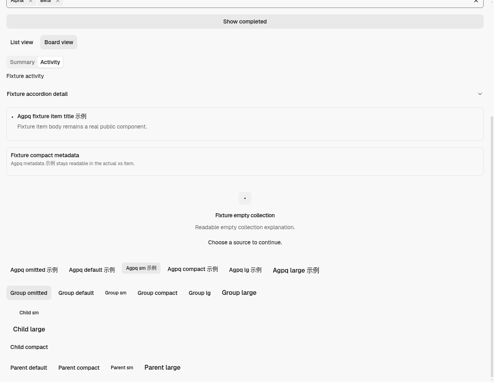
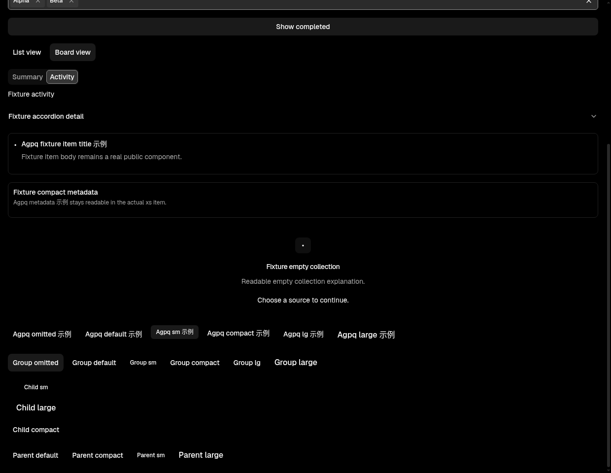
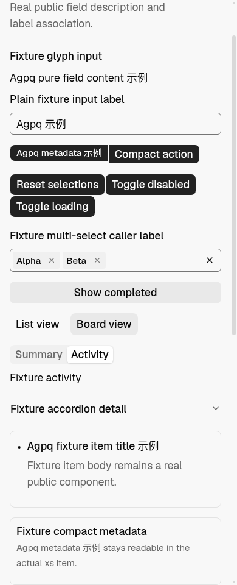
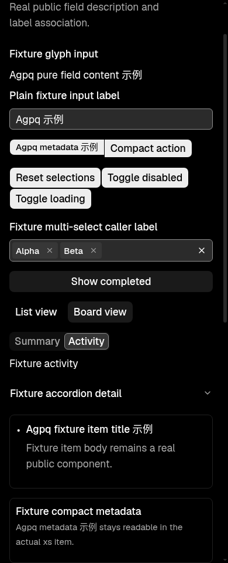
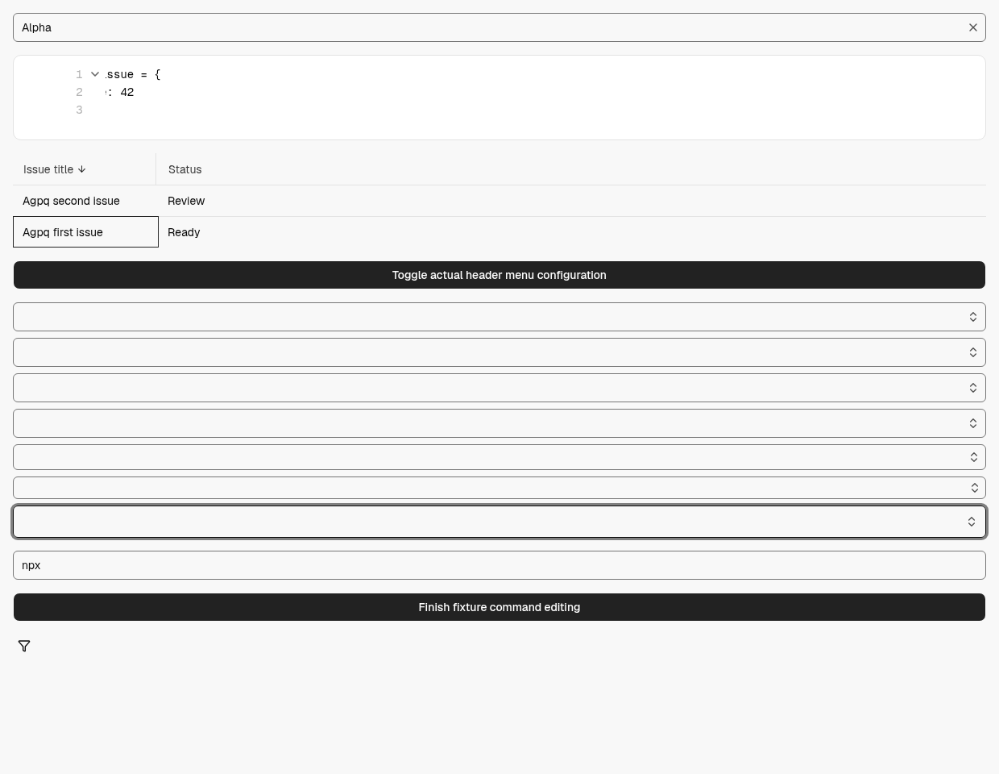
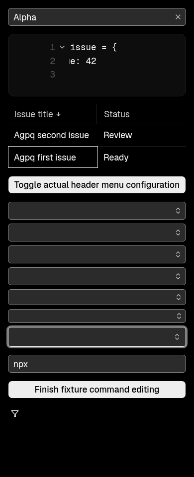
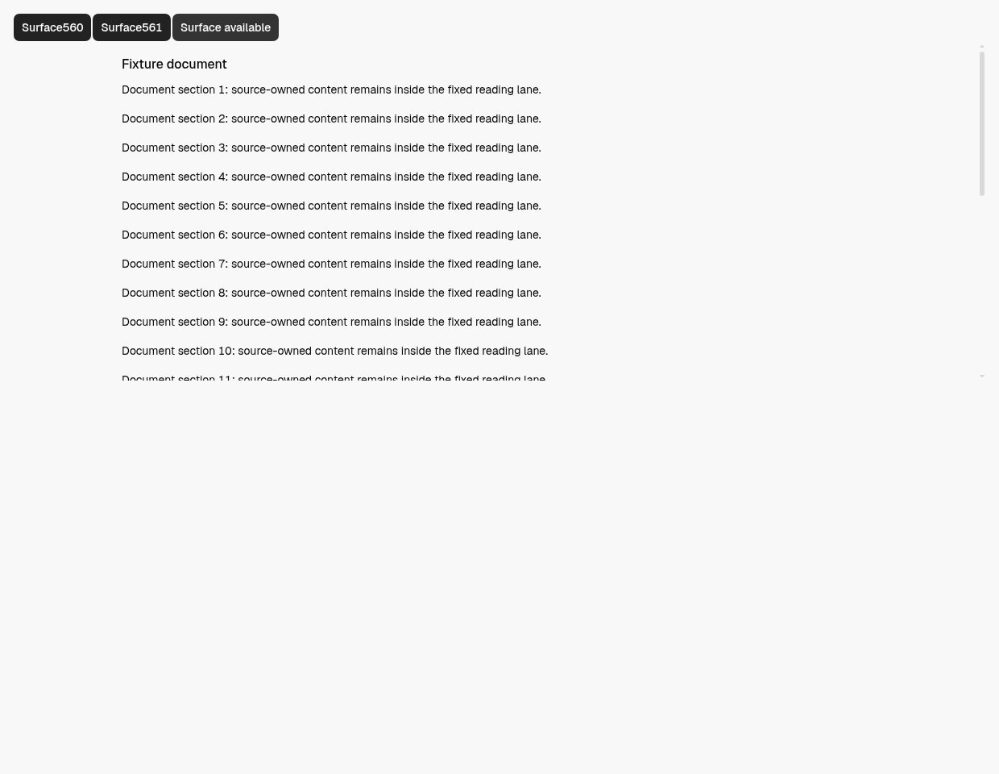
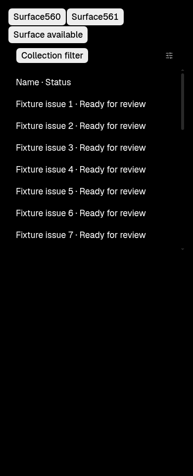

# DESIGN.md shared controls and geometry evidence

Product head: `496b70b6e6d4a9b55f7a5be42459808f88a9d75a`; base: `7a0db38fc2a78dc0c145ce180bcd638ae9dfeb6c`. The candidate changes 81 files.

The [complete archive](./complete-verification.zip) preserves the original reports, all actual captures and computed-style/business records, exact before/after sources and public compiler output. [The input manifest](./archive-input-manifest.json) records each original SHA-256 and byte count. Browser profiles, dependencies and regenerable caches are excluded.

## Actual verification and correction boundary

- Native005 ran the real current source components with Desktop renderer configuration, application theme/locale/query providers, live CSS module identities and production compiled CSS. It captured all 136 scenes across light/dark, 1240/390px and root16/root20: 1544 checks passed; eight old screen-reader-only CSS predicates failed.
- Native006 exercised the eight affected Projects contexts using the same actual source/CSS pipeline. All 56 focus, hidden-input geometry, keyboard and callback checks passed. Eight UA declaration decoder checks failed because Chromium reports `clip !important` and its separate important flag.
- The [actual offline decode](./offline-result.json), using public PostCSS 8.5.28, strictly parses those eight original UA records, preserves their cascade order, verifies both original compiled CSS inputs and all 38 input hashes, and passes eight checks. The [bounded execution](./offline-execution.json) exits zero with owned-process closure and no OOM. It performs no renderer rerun.

**Original Native005 and Native006 reports remain `passed: false`, byte-for-byte.** The corrected predicate evidence is a separate result; it is not a rewritten native report. The combined evidence addresses the two obsolete assertion formats. [Independent final review](./independent-final/review.md) completed with no confirmed findings; all four initial omissions are resolved. The [unmodified final artifacts](./independent-final.zip) preserve original hashes and exhausted review budgets. Normal merge still requires the delivered PR-head checks. These fixtures do not prove the entire routed app, backend, local agents, the unpublished SDK continuation or all remaining goals.

The archive also contains the actual 34-assertion compiled leading proof at `ccdc8c0`; the later head changes only Select behavior and no CSS. The Escape regression demonstrates three failures before the actual fix and four passes afterward, with a separate pure-format chain to this head. No component test was added to the repository.

## Representative actual captures

| Light                                                            | Dark                                                            |
| ---------------------------------------------------------------- | --------------------------------------------------------------- |
|        |        |
|  |  |
|   |    |
|            |         |

Current-head push CI passed Test CI, E2E CI and UI alignment. PR-required checks are assessed independently when the PR exists. #577 and #690–694/#696/#697 are not marked complete by this scoped delivery.

The documentation-only successor `f7a97a528489e5e4d6e85431365ded85568346fb` adds the development explanation. [Exact source reuse](./docs-only-source-reuse-receipt.json) verifies every one of the 81 product/instruction blobs and modes is unchanged from the tested head. The native and prior CI results retain their original head identities; current PR checks are assessed separately.
